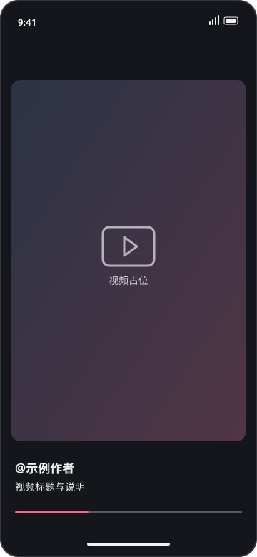
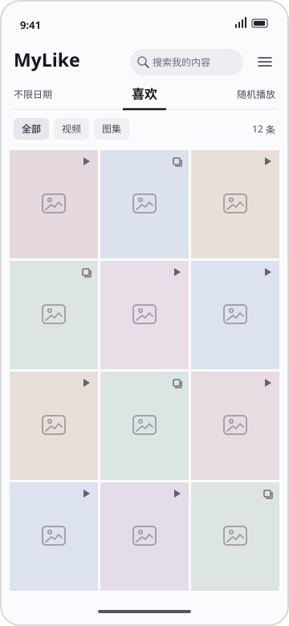

<div align="center">


# MyLike 移动端

**在 iPhone 和 Android 上回看你的喜欢。**

导入 MyLike 桌面端的喜欢清单，随时查找、播放和续看。

[](https://github.com/Hannah2227/mylike-mobile/releases)
[](https://github.com/Hannah2227/mylike-mobile/releases)
[](LICENSE)

[下载应用](https://github.com/Hannah2227/mylike-mobile/releases) · [功能特性](#功能特性) · [界面预览](#界面预览) · [快速上手](#快速上手) · [反馈问题](https://github.com/Hannah2227/mylike-mobile/issues)

</div>

## 界面预览

<div align="center">
<table>
  <tr>
    <th>播放页</th>
    <th>内容库</th>
  </tr>
  <tr>
    <td></td>
    <td></td>
  </tr>
</table>
</div>

## 下载

前往 [GitHub Releases](https://github.com/Hannah2227/mylike-mobile/releases) 下载。

> 注意：移动端不用登录，但是只能播放不能采集，需要通过 MyLike 桌面版导出列表后再导入

### Android

下载 `.apk`，在手机上打开文件并按系统提示安装。

### iPhone

下载 `.ipa`。在电脑上用 Sideloadly 签名并安装。

1. 用数据线连接设备 在 iPhone 上点「信任此电脑」并输入锁屏密码。
2. 下载iTunes和Sideloadly，然后打开 Sideloadly，确认顶部识别到你的设备。
3. 把未签名的 .ipa 拖进 Sideloadly 窗口。Apple ID 填你的，不用填密码到这里。
4. 点 Start 按提示输入 Apple ID 和密码。
5. 等待安装完成，看到 ✅ Done。
6. iPhone 上信任证书：这两步必做，否则打不开。
   - 设置 → 通用 → VPN 与设备管理 → 找到你的 Apple ID → 点「信任」
   - 设置 → 隐私与安全性 → 开启开发者模式
7. 打开 App。免费 Apple 账号签名需要定期续签。

## 功能特性

- **导入喜欢** — 支持导入 MyLike 桌面端导出的 JSON，预览新增与重复条数，按作品 ID 合并。
- **随手找到** — 三列封面浏览，支持按标题或作者搜索，以及按作品类型和发布时间筛选。
- **滑动回看** — 上下滑切换作品，图集内左右滑翻页。支持视频、图集配乐和有可用片段的实况图集。
- **播放队列** — 点开封面顺序播放，或把当前筛选结果随机排列。可切换自动连播、倍速和清屏。
- **断点续播** — 记录上次作品、视频时间或图集页码。回到内容库后，向右滑可继续上次回看。

## 快速上手

1. **准备清单** — 在 MyLike 桌面版导出 JSON。
2. **导入手机** — 把 JSON 保存到手机的「文件」或「下载」。打开 MyLike，在内容库选「导入清单」。
3. **开始回看** — 点开一张封面，或点「随机播放」。横拖视频底部可跳转，长按画面中间可打开播放选项，左滑右滑可切换播放页和内容页。

播放时需要联网，手机会按作品 ID 实时获取媒体地址，无需登录抖音。遇到作品失效或接口受限时，可以重试或划到下一条。

## 开发

使用 React Native、TypeScript、Expo SDK 58 和 SQLite。构建工作流使用 Node.js 24.12.0。

```sh
npm ci
npm start
```

使用支持 SDK 58 的 Expo Go 调试。`npm run typecheck` 检查类型，`npm test` 运行测试。维护者可以在 Actions 手动运行 **Build Android test APK** 和 **Build iPhone test IPA**，在构建结果的 Artifacts 区获取独立测试包。 [Expo Go](https://expo.dev/go) · [构建工作流](https://github.com/Hannah2227/mylike-mobile/actions)

## 免责声明

- **项目关系** — MyLike 移动端是独立开发的个人回看工具，与抖音及字节跳动无关联，也未获其授权或背书。
- **内容与授权** — 请仅导入本人或已获授权的清单，遵守适用法律法规、平台服务条款和内容权利人的授权范围。视频、图片、音乐及平台标识的权利归各自权利人所有。转载、传播或商业使用须取得相应授权。
- **数据与隐私** — 内容库和观看进度保存在设备上。分享清单或提交问题前，请检查作品列表及截图中是否包含不愿公开的信息，并保留原始清单以便重装后恢复内容库。
- **可用性与责任** — 播放依赖网络、作品状态和第三方接口。作品下架、接口调整或访问受限可能影响播放。软件按现状提供，担保及责任限制以适用法律和 [MIT License](LICENSE) 为准。

## 许可证

本项目的源代码和文档采用 [MIT License](LICENSE)。第三方组件适用各自的许可证。
